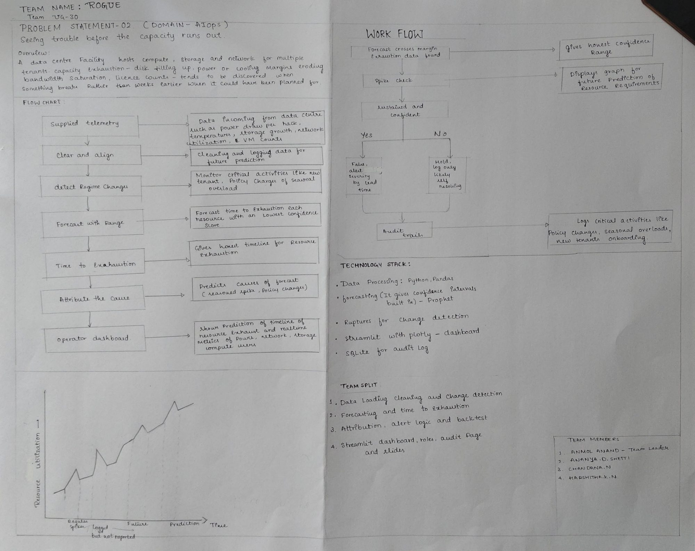
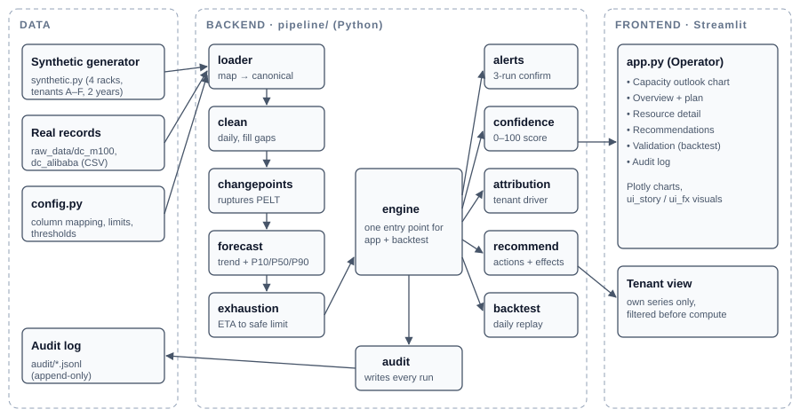
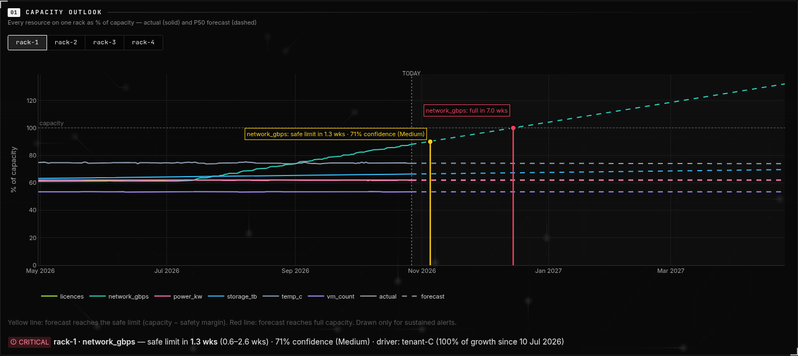
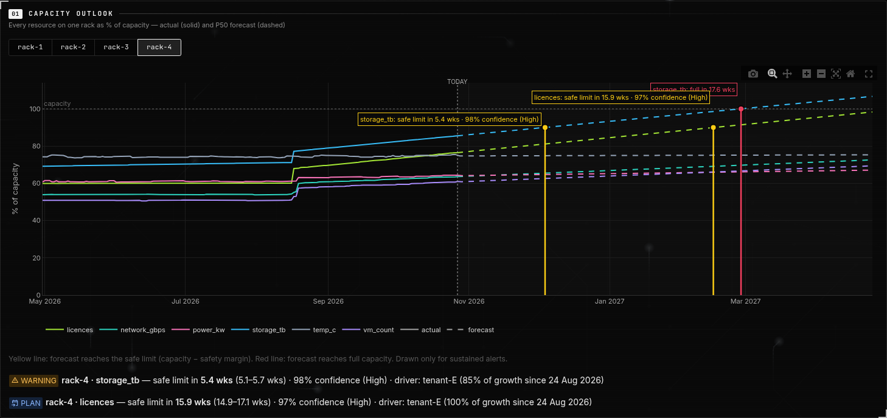
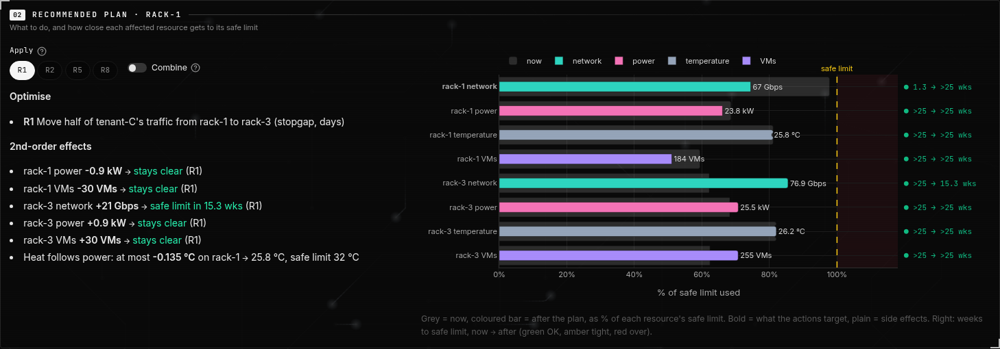
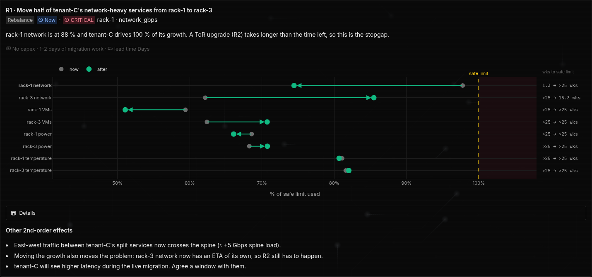
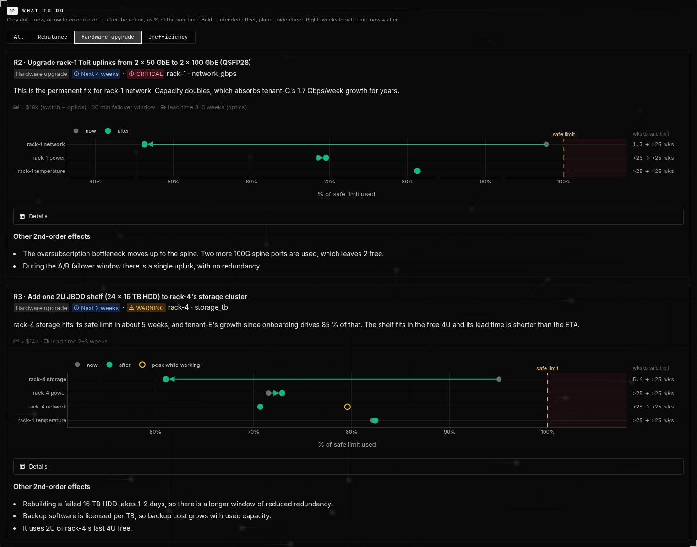
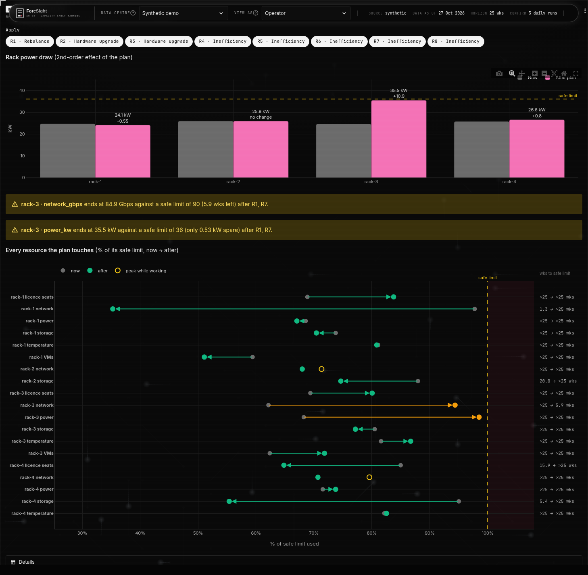
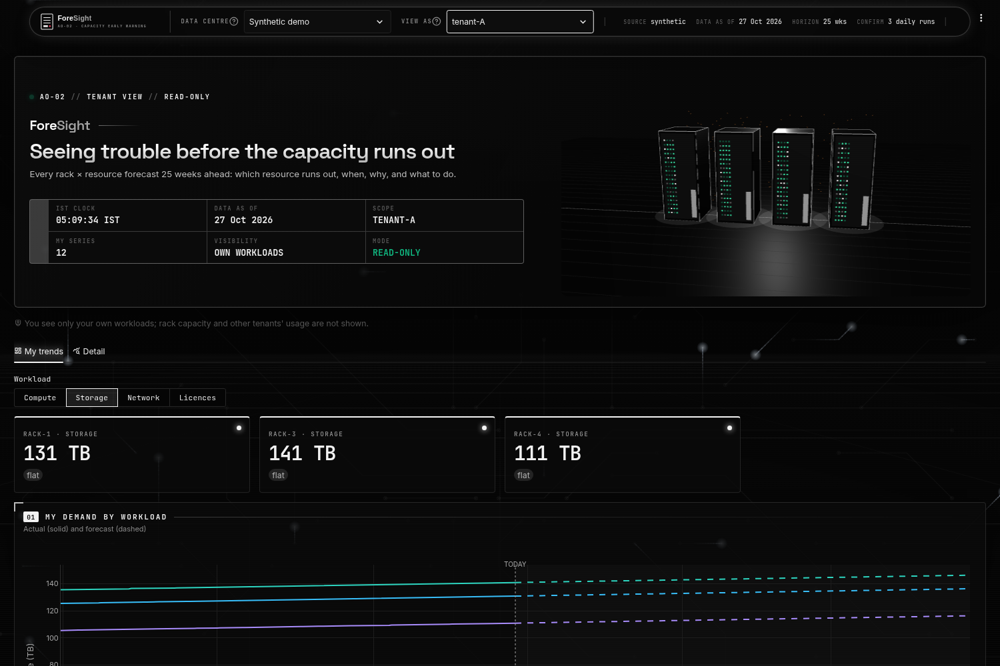

# ForeSight — Complete Project Documentation

## 1. Project Details

- **Project title:** ForeSight
- **Team name:** Rogue
- **Team ID:** TEAM-1H4BPX
- **Roll no.:** UG-30
- **Problem statement:** PS-02 (Domain: AIOps): *Seeing trouble before the capacity runs out*
- **Team members:**
  1. Anmol Anand (Team Leader)
  2. Chandana N
  3. Harshita KN
  4. Ananya D Shetti

## 2. Problem Statement

> A data-centre facility hosts compute, storage and network for multiple tenants. Capacity exhaustion — disk filling up, power or cooling margins eroding, bandwidth saturation, licence counts — tends to be discovered when something breaks rather than weeks earlier when it could have been planned for.

## 3. Understanding the Problem

- Many tenants share the same racks. Each rack has limited **storage, power, cooling, network bandwidth, VM slots and licences**.
- Usage grows slowly, then sometimes jumps (a new tenant, a policy change, a seasonal load).
- Today the problem is found **only when something breaks**: a full disk, a tripped power budget, a saturated uplink.
- What is needed is an early warning that says, weeks in advance:
  - **which** rack and resource will run out,
  - **when** (with an honest range, not one exact date),
  - **why** (which tenant or change is driving the growth),
  - **what to do** about it.
- Short spikes must **not** raise alarms. Otherwise operators stop trusting the alerts.
- Tenants should only see their own usage, never other tenants'.

## 4. Phase 1 — Initial Analysis

**Initial ideas and offline discussion**

- Treat each rack × resource as a time series and forecast it forward.
- Detect *regime changes* (new tenant, policy change, seasonal overload) so that the forecast only uses the data after the latest change.
- Give a forecast **range** and a **confidence score** instead of one number.
- Alert only when the crossing is **sustained and confident**. A spike is logged but not reported.
- Keep an **audit trail** of every forecast and alert.

**Solution presented on the cardboard sheet**

- **Flow chart:** Supplied telemetry → Clean and align → Detect regime changes → Forecast with range → Time to exhaustion → Attribute the cause → Operator dashboard.
- **Workflow:** Forecast crosses margin → Spike check → Sustained and confident?
  - **Yes:** alert, with severity based on lead time.
  - **No:** hold and log only (likely self-resolving).
  - Both paths go to the **audit trail**, which logs policy changes, seasonal overloads and new tenant onboarding.
- **Planned tech stack:** Python, Pandas, Prophet (forecasting with confidence intervals), Ruptures (change detection), Streamlit + Plotly (dashboard), SQLite (audit log).
- **Team split:**
  1. Data loading, cleaning and change detection
  2. Forecasting and time to exhaustion
  3. Attribution, alert logic and backtest
  4. Streamlit dashboard, roles, audit page and slides

*Figure 1: The Phase 1 sheet: problem, flow chart, workflow, tech stack, team split.*

## 5. Requirements Analysis

**Identified problem:** capacity exhaustion is found reactively, after a failure, instead of being planned for weeks in advance.

**Users and their needs**

- **Operator:** sees every rack and resource, gets early and reliable alerts, knows the cause and the fix.
- **Tenant:** sees their own usage trend only.

**Objectives**

- Forecast every rack × resource and estimate the time until it reaches its safe limit.
- Alert early (weeks of lead time) with few false alarms.
- Explain the cause and suggest actions.

**Constraints**

- Read-only: the tool never changes facility controls.
- Real telemetry is limited and messy (gaps, different formats, different units).
- Tenant data must stay isolated.

**Functional requirements**

- Load telemetry, limits and events from files, with configurable column mapping.
- Clean, resample and fill short gaps.
- Detect change points, forecast with P10/P50/P90 bands, and compute the ETA to the safe limit.
- Alert after 3 consecutive confirming runs, with severity CRITICAL, WARNING or PLAN.
- Attribute growth to tenants.
- Recommend actions and show their side effects.
- Operator and tenant views, a validation (backtest) tab and an audit log tab.

**Non-functional requirements**

- Explainable output (range + confidence + driver).
- Auditable: every run logged with a hash of the data it used.
- Responsive UI: results are cached.
- Easy to switch to new data: all settings live in `config.py`.

## 6. Proposed Solution

ForeSight is a **read-only early-warning dashboard**. For every rack × resource it shows:

- **Which** resource will run out: a status of CRITICAL, WARNING, PLAN, HOLD or OK.
- **When:** likely ETA with an earliest–latest range, and a 0–100 confidence score.
- **Why:** the tenant driving the growth, and since when.
- **What to do:** recommended actions (rebalance, hardware upgrade, fix an inefficiency), with their 1st- and 2nd-order effects (for example power → heat).

How it addresses the problem:

- Forecasting the trend finds the problem **weeks before** the failure.
- The 3-run confirmation and spike handling keep false alarms low.
- The backtest replays history day by day to **prove** the lead time.

## 7. Methodology

1. **Load:** map raw files to three tables: telemetry, limits, events. Fall back to synthetic data if none are supplied.
2. **Clean:** resample to daily values and fill gaps of 3 days or less. Build a series per rack × resource and per tenant.
3. **Detect change points:** Ruptures PELT on the 7-day rolling median.
4. **Forecast:** a linear trend after the last change point, with P10/P50/P90 bands over a 180-day horizon.
5. **Time to exhaustion:** the first day each band crosses capacity − safety margin.
6. **Alert:** the P50 crossing must hold on 3 consecutive runs. Severity by lead time: CRITICAL < 2 weeks, WARNING 2–8 weeks, PLAN > 8 weeks. Otherwise HOLD.
7. **Confidence:** ETA-range tightness, trend fit (R²), amount of data, and agreement between runs.
8. **Attribute:** each tenant's share of the growth.
9. **Recommend:** actions and their side effects.
10. **Audit:** append every run to a JSONL log.
11. **Display:** in the Streamlit dashboard.

## 8. System Architecture

*Figure 2: ForeSight architecture.*

- **Frontend:** Streamlit (`app.py`) with Plotly charts. The operator view has Capacity outlook, Overview, Resource detail, Recommendations, Validation and Audit log. The tenant view has My trends and Detail.
- **Backend:** Python modules in `pipeline/`. `engine.py` is the single entry point, used by both the app and the backtest.
- **Data storage:** CSV files (synthetic data or real records) and append-only JSONL audit logs. There is no database server.
- **APIs:** none external. Components call each other as Python functions.
- **Interaction:** app → engine → loader/clean/forecast/alerts → results are cached → charts. Every run is written to the audit log.

## 9. Technologies and Tools

- **Language:** Python 3
- **Data:** Pandas, NumPy
- **Change detection:** Ruptures (PELT)
- **Forecasting:** linear trend with prediction bands (our own code)
- **Dashboard:** Streamlit, Plotly
- **Storage:** CSV, JSONL audit log
- **Testing:** Streamlit AppTest, `selfcheck.py`, Playwright with headless Chromium (screenshots)
- **Version control:** Git

## 10. Phase 2 — Implementation

**Features developed**

- Data loader with a configurable mapping, plus a synthetic data generator (4 racks, tenants A–F).
- A full pipeline: clean → change points → forecast → ETA → alerts → confidence → attribution.
- Backtest that replays every day of history using only the data available up to that day.
- Operator dashboard: Capacity outlook chart, KPI row, tenant demand chart, headroom bars, gauges, exhaustion table.
- Recommendations tab: rack specs, action cards with effect charts, a Kind filter, and a combined plan.
- Tenant view with strict isolation.
- Audit log viewer and a data-centre record selector.
- Converters for two real public datasets (M100 CINECA and the Alibaba 2018 trace).

**Changes from the Phase 1 plan**

- Forecasting uses a linear trend after the last change point instead of Prophet.
- The audit log is append-only JSONL files instead of SQLite.

**Progress:** all planned modules are implemented and run end to end on synthetic and real data.

## 11. Phase 3 — Testing

**Approach**

- UI tests drive the real app with Streamlit AppTest.
- Pipeline tests call the loader and the forecast code directly with small test files.
- `selfcheck.py` runs the whole pipeline, the backtest and both views.
- Test types: positive, negative, boundary and validation.

| ID | Feature | Type | Expected | Actual | Status |
|---|---|---|---|---|---|
| TC-01 | Record selector | Positive | 3 records, Synthetic by default | As expected | Pass |
| TC-02 | Record selector | Validation | Old rack pick reset on switch | Reset to rack-02 | Pass |
| TC-03 | Resources chart | Positive | Chart redraws for rack-4 | Redrawn, no error | Pass |
| TC-04 | Resources chart | Boundary | Clearing the rack falls back to the worst rack | Fell back to rack-1 | Pass |
| TC-05 | Alert lines | Validation | Every alert has an ETA line | 4 alerts, all with lines | Pass |
| TC-06 | Recommendations | Positive | Tab renders fully | 8 actions, charts shown | Pass |
| TC-07 | Kind filter | Positive | Only R2, R3 shown | R2, R3 shown | Pass |
| TC-08 | Combined plan | Boundary | 0 actions handled safely | 0 rows, no warnings | Pass |
| TC-09 | Combine toggle | Validation | “Pick at least one action.” | Message shown | Pass |
| TC-10 | Plan maths | Validation | Deltas add up correctly | No mismatches | Pass |
| TC-11 | Tenant view | Security | No other tenant visible | None visible | Pass |
| TC-12 | Loader | Negative | Clear error for a missing column | Error names the column | Pass |
| TC-13 | Loader | Negative | Junk values dropped | 2 of 4 rows kept | Pass |
| TC-14 | ETA | Boundary | Edge days exact | All correct | Pass |
| TC-15 | Loader | Negative | Bad date row dropped | Loader crashed (ValueError) | **Fail** |

**Result:** 14 of 15 passed. Full details and screenshots are in `ForeSight_Test_Cases.pdf`.

**Improvements**

- Edge cases found in testing (an empty selection, a cleared rack control, a resource already past its limit) are handled in the code.
- TC-15 is still open. Fix: add `errors="coerce"` when parsing dates in `pipeline/loader.py`.

## 12. Application Screenshots

*Figure 3: Capacity outlook. Every resource on rack-1 as % of capacity. Solid line = actual, dashed = forecast. The yellow line marks when the forecast reaches the safe limit, the red line when it reaches full capacity.*

*Figure 4: The same chart for rack-4, showing a storage WARNING and a licences PLAN alert with their drivers.*

*Figure 5: Overview: the recommended plan for the selected rack and how close each affected resource gets to its limit.*

*Figure 6: A recommendation card: the action, why it is needed, cost and lead time, the effect on each resource, and side effects.*

*Figure 7: Recommendations filtered to hardware upgrades only.*

*Figure 8: Combined plan: rack power draw and every resource with all actions applied.*

*Figure 9: Tenant view: tenant-A sees only its own workloads.*

## 13. Challenges and Solutions

- **Gathering real-world data**
  - *Challenge:* no single public dataset has power, storage, network, VM and licence data per rack and per tenant.
  - *Solution:* we built a synthetic generator for the full demo scenario. We also converted two public traces (M100 CINECA, Alibaba 2018) into separate data-centre records using converters in `tools/`.
- **Implementing edge cases**
  - *Challenge:* short spikes, data gaps, resources already past the limit, empty user selections, and switching between data centres.
  - *Solution:* the 3-run confirmation, spike checks, gap filling, fallbacks for empty selections, a state reset when the data centre changes, and test cases for each.

## 14. Results and Outcomes

On the synthetic data (`selfcheck.py`):

- **4/4** historical exhaustion events caught, with a mean lead time of **12.7 weeks** (minimum 9.9).
- **0** false alarms. **0 of 5** short spikes raised an alert.
- Forecast error (MAPE): **1.7 %** before events, **2.5 %** over the last 30 days.
- Live alerts: CRITICAL on rack-1 network, WARNING on rack-4 storage, PLAN on rack-4 licences and rack-2 storage.

This meets the objectives: warnings weeks ahead, with a range, a cause and an action, and with almost no false alarms.

## 15. Limitations and Future Enhancements

**Limitations**

- The results are measured on synthetic data that we designed. Real data may score lower.
- The real datasets lack per-tenant storage, network and licence data. Racks and tenants in them are partly synthetic.
- The forecast is a linear trend. It does not model seasonality (for example the 24-hour cycle in the Alibaba data).
- A malformed date stops a data file from loading (TC-15).
- The selected data centre is shared across browser sessions.

**Future enhancements**

- Seasonal forecasting models.
- Live data ingestion instead of files.
- Email or chat notifications for alerts.
- Real login and roles.
- Fixes for TC-15 and the shared-session issue.

## 16. Conclusion

- In **Phase 1** we analysed PS-02 and designed a flow: clean → detect changes → forecast with range → time to exhaustion → attribute → dashboard, with an audit trail.
- In **Phase 2** we built ForeSight: the full pipeline, a backtest, recommendations, and operator and tenant dashboards.
- In **Phase 3** we tested it with 15 test cases (14 passed). The backtest catches every historical exhaustion event about 12 weeks early with no false alarms.
- ForeSight turns capacity exhaustion from a surprise into something that can be planned for weeks in advance.
